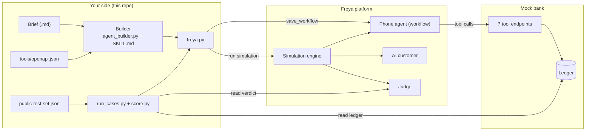
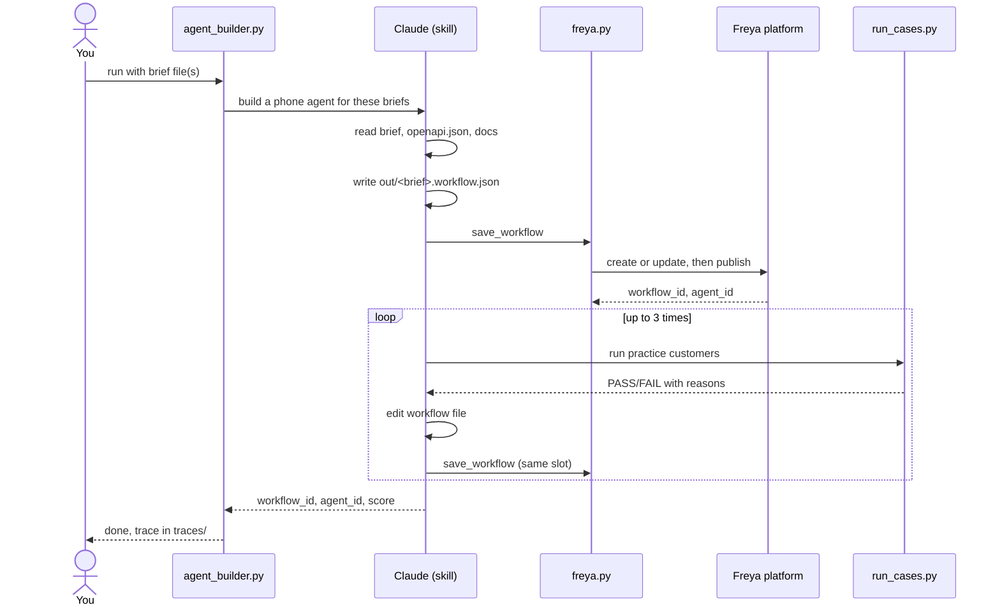
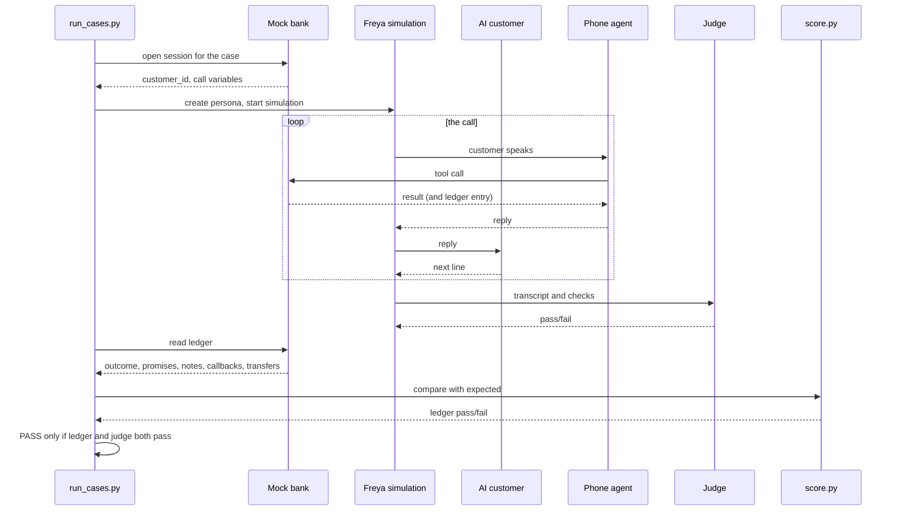

# Architecture

You write a **builder**. It reads a bank brief and creates a **phone agent** on Freya's platform. Freya tests that agent against simulated customers and a mock bank, and the score comes from the bank's records plus a judge's reading of the transcript.

## 1. Architecture

Three parties are involved:
- **Your side (this repo):** the builder, the API client and the test runner. This is the only part you write.
- **Freya platform:** hosts the phone agent and runs the simulation, the AI customer and the judge. The agent's model is fixed by Freya.
- **Mock bank:** exposes the seven tools the agent calls and keeps a ledger of what actually happened. The scorer trusts the ledger, not the agent's words.

## 2. Sequence: building the agent

Claude reads the brief and writes a workflow JSON. It saves it to Freya (updating the same workflow each time, never creating a new one), tests it on the practice customers and fixes what fails, at most three times. The builder's trace is written to `traces/` and is part of what you submit.

## 3. Sequence: grading one customer

An AI customer talks to the phone agent, and every tool call lands in the bank's ledger. Afterwards two checks run: the ledger is compared with the expected records, and a judge reads the transcript for policy and honesty. A case passes only if both pass, with no partial credit. In the final, each case runs three times and all three must pass.

